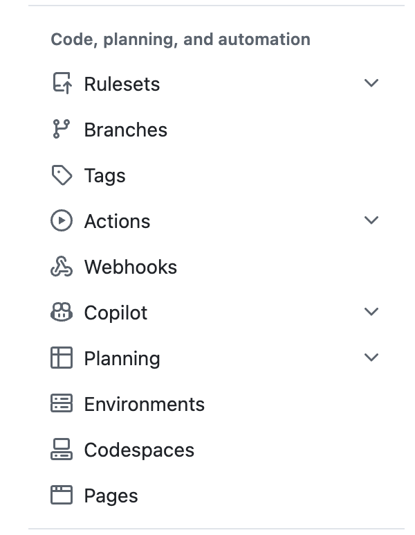

## Today's Plan
- Reading for next week - VOTE
- Communciating Data
- Bibliographies/citing work
- **(tech)** Walk through steps for creating a website
- Updating and maintaining

## What do you want to read next?

## Creating an Outline
- [Prison Policy Initiative's Guide to Writing about the Criminal Legal System (and other complex topics)](https://www.prisonpolicy.org/trainings/writing_guide.html) 

## Biliography

- Zotero w/ Biblatex plugin
- Biblatex
- BibIt

## Biblatex
```
@article{ovienmhada,
  title = {Resisting {{Detached Datafication}}: {{What Toxic Prisons Teach Us}} about the {{Imperative}} of {{Restorative}}/{{Transformative Data Science}} for {{Environmental}} and {{Social Justice}}},
  author = {Ovienmhada, Ufuoma},
  langid = {english},
  file = {/Users/nstevens/Dropbox/zotero/files/Ovienmhada - Resisting Detached Datafication What Toxic Prisons Teach Us about the Imperative of RestorativeTra.pdf}
}

```
## Where to get biblatex?
1. Zotero (demo)
2. Browser extension (demo)
3. Google Scholar (demo)
4. DO NOT HAND WRITE IT

## Where to PUT biblatex
- in your `bibliography.bib` file
- in the same folder as your project


## By the end, you should know:

- How to make your own website for a portfolio, event, or just for fun!
- How to create a custome domain

## Using a template or starting from scratch

- Either way is perfectly fine, its users preference.
- **Utilize public github repos!!!!**
- Search on github for a template you like, clone repo!

## What is Github Pages?

- Staic site hosting service
- Takes HTML, CSS, and JS files right from a repo, builds, and publishes a website
- You can host your own domain or use the standard github.io/user domain

## Necesssary Files

- index.qmd
  - Default homepage, primary entry point
- _quarto.yml
  - Config file, themes, layouts, visuals

## Setting up Pages

{width=400} 

Build and deployment, deploy from branch 
chose main and /docs folder! 

## Custom domain
- If you choose, you can go to any domain site and pay cents for a domain, namecheap
- Type in the settings, DNS check to see if it is a real domain 

## Live demo
- My websites!