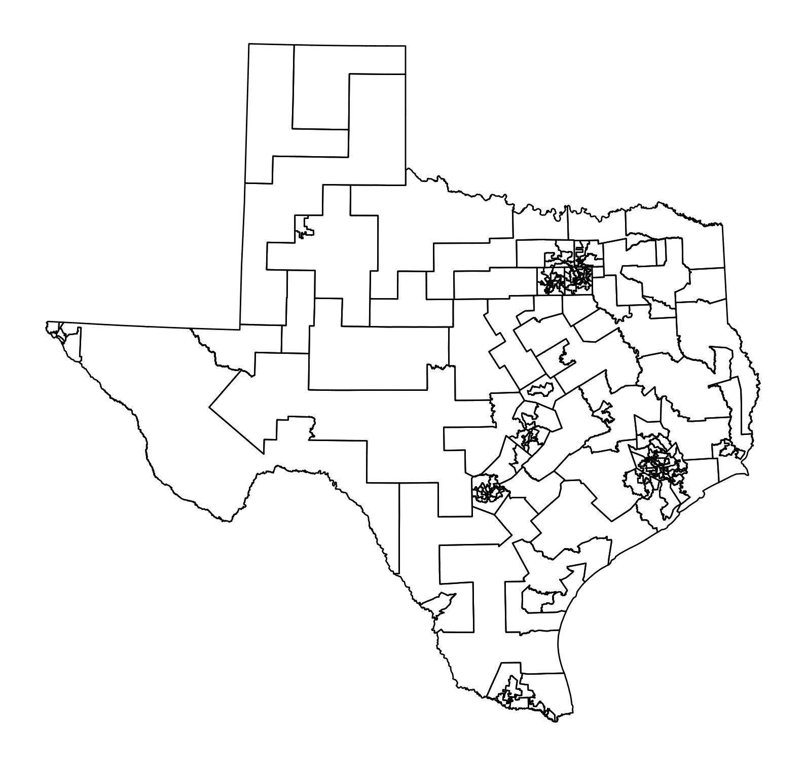
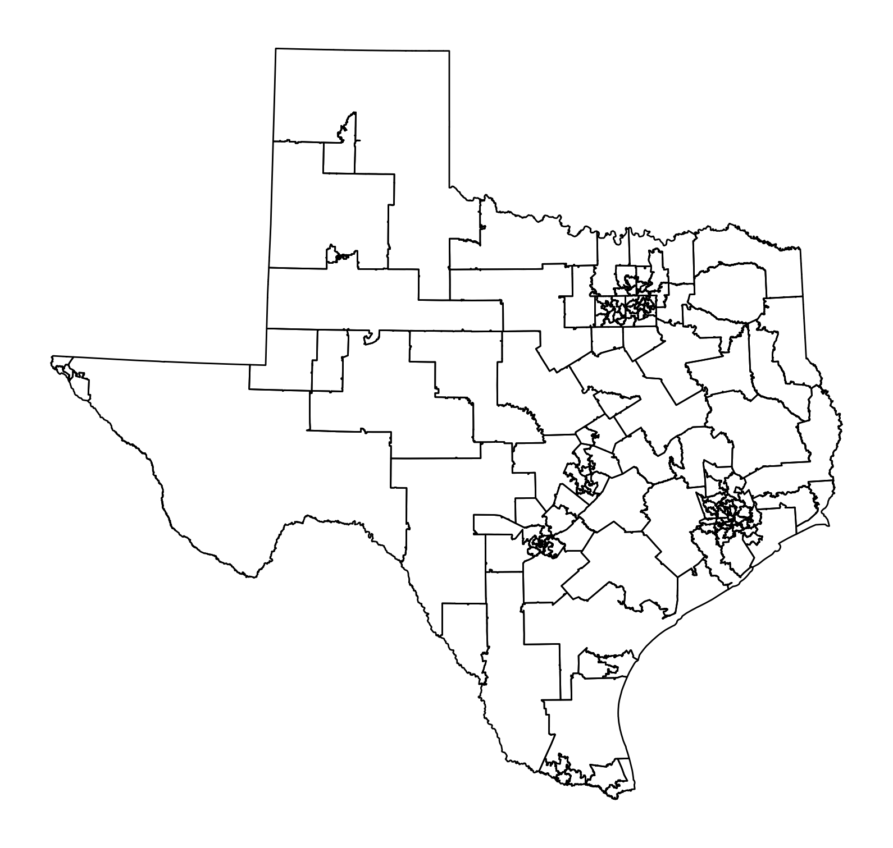
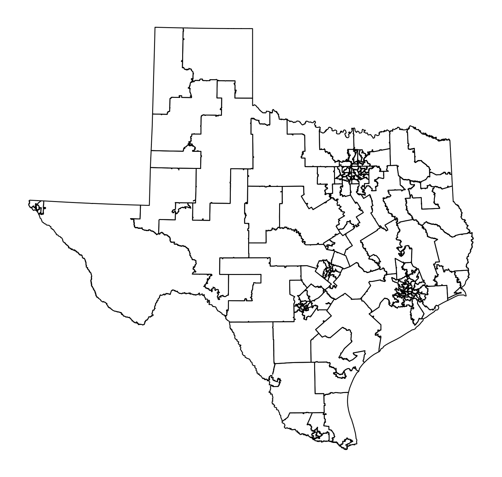
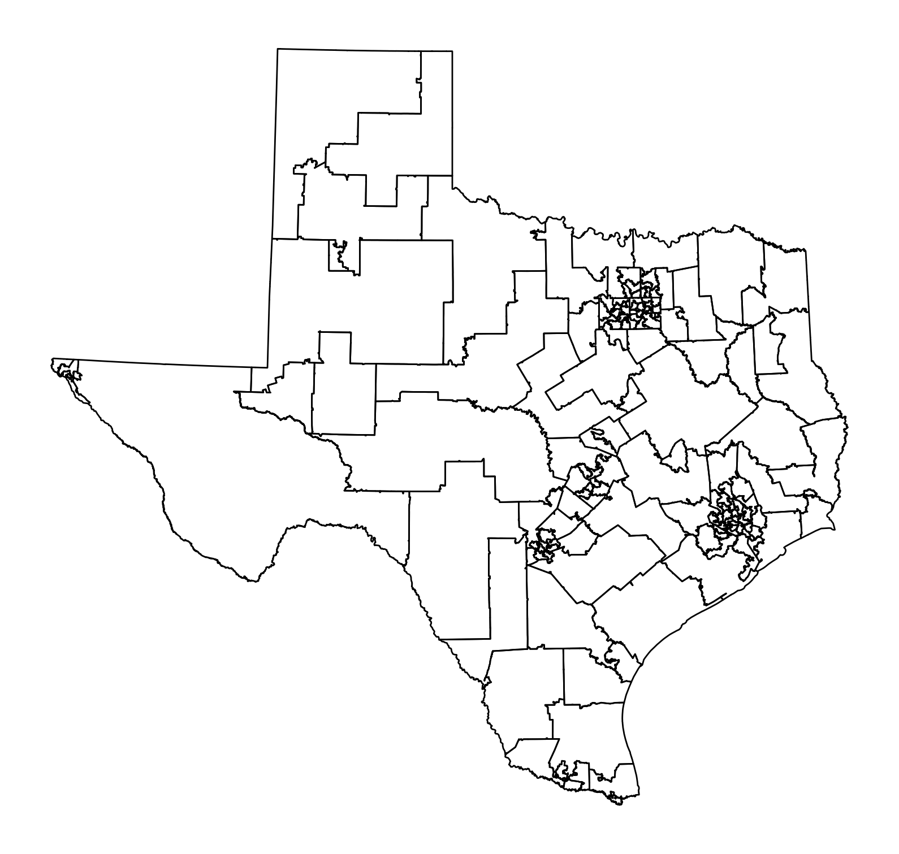
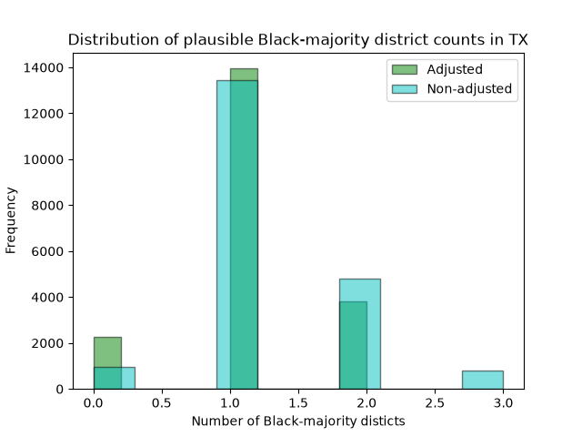
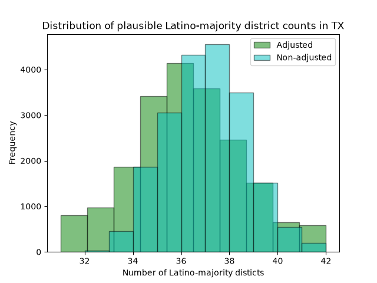
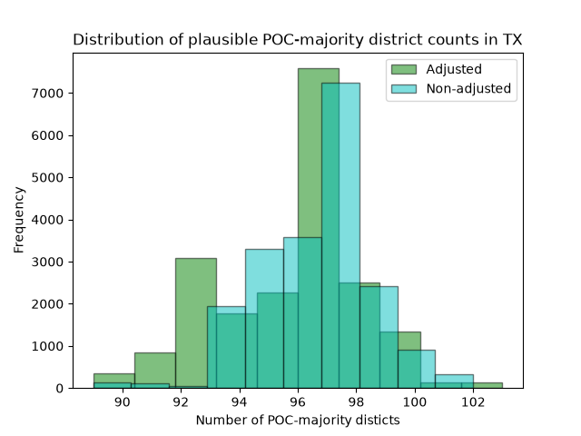

## Introduction

Prison gerrymandering is the phenomenon of counting incarcerated individuals at the address of their carceral facility for the purpose of redistricting. The practice reflects the U.S. Census, whose "usual residence rule" stipulates that individuals be counted at “the place where they live and sleep most of the time” on Census Day. However, though counting incarcerated people at their carceral addresses is consistent with U.S. Census Bureau policy, this practice has a wide range of knock-on effects. For example, a counterfactual analysis by Remster et. al. revealed that prison gerrymandering inflates the influence of voters in the predominantly white counties where carceral facilities are located, while simultaneously deflating the voting power of those in the predominantly Black neighborhoods from which, by virtue of the racialized nature of American mass incarceration, incarcerated individuals tend to be drawn[@remster2018shifting]. Further, since these majority white counties are typically suburban and rural, whereas the predominantly Black neighborhoods are often urban, Remster et. al. argue that prison gerrymandering also displaces voting power from urban areas out to suburban and rural ones[@remster2018shifting]. The electoral effects of this shift remain an open question. In a study of New York State after its prohibition on prison gerrymandering, Williamson and King estimate that the state's ban did have electoral consequences, to the benefit of state Democrats.[@williamson2022redistricting] However, in their ensemble analysis on New York State maps before and after its prison gerrymandering ban, White et. al. assert that the legislation had very little impact on the possible electoral results.[@white2024prison]

This project investigates a very similar question, asking: Would a statewide prison gerrymandering ban have a measurable impact on the number of minority black state house districts in Texas? This shift from a focus on partisan outcomes to racial ones is motivated by a few considerations: first, the availability of the counterfactual data on which the analysis is based, which includes adjusted demographic totals by Census block, but no information on adjusted electoral results. Second, this analysis is also motivated by outside research conducted by the author on detecting minority vote dilution during redistricting.

Similar to Williamson and King, this project takes a counterfactual approach; using Remster et. al.'s adjusted Census block level population counts, which correctly reassign prisoners to their home counties, an ensemble method is used to determine the range of possible TX electoral maps under the original and counterfactual demographic conditions[@williamson2022redistricting][@kramer2026dataset]. For each possible map, the number of majority Black, majority Latino, and majority-person-of-color (POC) districts are counted, providing a plausible distribution of the number of Black and Latino districts per plan under both the original and counterfactual conditions.

::: callout-Results
Initial results reveal that the distribution of minority-majority districts per plan is either not affected or is negatively affected by reallocation of incarcerated individuals . However, further investigation is necessary to verify this claim.
:::

## About the Data

This dataset contains 2020 Census demographic data at the Census block level for Texas. Each row represents a single Census block, and the dataset holds original and adjusted demographic information for all 668,757 blocks in the state. The demographics that the dataset tracks are the original and adjusted total population of a block and the total Black, White, Latino, and "other" populations, where all four categories follow the U.S. Census definitions.

## The Process

This project utilized ReCombination (ReCom), a form of Markov-Chain Monte Carlo (MCMC) sampling introduced by DeFord, Duchin, and Solomon in their paper "Recombination: A family of Markov chains for redistricting."[@deford2021recombination] ReCom samples from the distribution of possible electoral maps by, at each step, combining two adjacent districts and randomly partitioning the product of the merge to create two new districts with different boundaries from the initial two.

In "Recombination," DeFord et. al. establish that 20,000 steps is generally sufficient to ensure that the sampled maps do not hinge too much on the initial starting partition.[@deford2021recombination] Thus, the ReCom procedure below is 20,000 steps long, meaning that it produces 20,000 distinct partitions (one per step). For each partition, demographic information is calculated for each district.

### Data Cleaning & Preprocessing

To perform EDA, counterfactual data at the state house district level was merged with TX district geometry [@dra2020districts]. All 150 districts were accounted for after the merge.

MCMC analysis was performed at the Census block level. Counterfactual data was merged with TX Census block geometry by 15-digit GEOID[@tlc2020blocks]. No data was lost as a result of the merge.

Further, in an effort to speed up running the chain, an attempt was made to aggregate Census blocks at the Census tract level, which would result in a 10-fold reduction in the number of geographic regions on which the ReCom sampling method would run. However, this methodology was revealed to have severe limitations when comparing the original and adjusted population data.

The final analysis was done at the Census block level.

### Exploratory Data Analysis

#### Which districts change drastically after adjustment?

Most of the districts that are too big after reallocation are near/encompassing cities, while the ones that shrink are in rural regions. This makes sense given Remster et. al.'s conclusions. One district that seems to defy this pattern is one the top right of the state; it is too large after redistricting, but does not contain a major Texas city.

```{python}
#| echo: false
import pandas as pd
import numpy as np
import geopandas as gpd
import matplotlib.pyplot as plt
import shapely

from gerrychain import  (
    GeographicPartition,
    Partition,
    Graph,
    MarkovChain,
    updaters,
    constraints,
    accept,
    Election,
)
from gerrychain.proposals import ReCom
from gerrychain.constraints import contiguous
from gerrychain.examples import gerrymandria
from functools import partial
import pandas
from gerrychain.accept import always_accept
from gerrychain.constraints import single_flip_contiguous
from gerrychain.proposals import propose_random_flip
from gerrychain.constraints import contiguous

import tqdm
```

```{python}
#| echo: false

# load in block level data
df = pd.read_excel('data/Texas_district_reallocation_results.xlsx')

# importing the 2022 HD shapes (this should be pre- recent mid-decade redistricting)
dist_shape = gpd.read_file('data/TX-2022-State-House-district-shapes-no-landmarks.geojson')

# switching the coordinate system for plotting
dist_shape = dist_shape.to_crs('EPSG:3081')
```

```{python}
#| echo: false
df_geom = pd.merge(
    dist_shape[['id', 'geometry']],
    df,
    how='left',
    left_on='id',
    right_on='district_h'
).drop(['id'], axis=1, errors='ignore')

df_geom['size'] = np.where(df_geom['toobig'] == 1.0, 'big',
np.where(df_geom['toosmall'] == 1.0, 'small', 'neither'))
```

```{python}
#| echo: false
color_map = {'neither': 'lightgrey', 'big': 'red', 'small': 'orange'}
color = df_geom['size'].map(color_map)
df_geom.plot(color = color)
```

#### Racial demographics of the regions most impacted

#### Black population

Districts that lose individuals seem to lose more Black individuals than districts that gain individuals tend to gain.

```{python}
# | echo: False
rel_districts = list(df_geom[df_geom['size'] != 'neither']['district_h'])

```

```{python}
#| echo: false
fig, ax = plt.subplots()

# df_geom['pct_black'] = df_geom['black'] / df_geom['total']

df_geom.plot(ax = ax, color = 'lightgrey')

df_select = df_geom[df_geom['district_h'].isin(rel_districts)]

df_select.plot(ax = ax, column = 'changeb', legend = True)

plt.title('Change in Black population in districts that change signicantly after adjustment')

df_geom[df_geom['toosmall'] == 1.0].plot(ax = ax, column = 'size', alpha = 0.5, hatch = '||', hatchcolor = 'white')

plt.show()

```

#### Latino population

Districts that lose individuals seem to lose more Latino individuals than districts that gain individuals tend to gain. However, the increases in Latino individuals in gain districts appears to be greater than their increases in Black individuals.

```{python}
#| echo: false
fig, ax = plt.subplots()

df_geom['pct_latino'] = df_geom['latino'] / df_geom['total']

df_geom.plot(ax = ax, color = 'lightgrey')

df_select = df_geom[df_geom['district_h'].isin(rel_districts)]

df_select.plot(ax = ax, column = 'changel', legend = True)

plt.title('Change in Latino population in districts that change signicantly after adjustment')

df_geom[df_geom['toosmall'] == 1.0].plot(ax = ax, column = 'size', alpha = 0.5, hatch = '||', hatchcolor = 'white')

plt.show()
```

#### Non-white population

Loss districts can lose up to over 8,000 POC individuals, while gain districts only gain a fraction of that value at most.

```{python}
#| echo: false
fig, ax = plt.subplots()

# df_geom['pct_n_white'] = (df_geom['latino'] + df_geom['black'] + df_geom['other']) / df_geom['total']

df_geom['change_n_white'] = (df_geom['changel'] + df_geom['changeb'] + df_geom['changeo']) 
# / df_geom['total']

df_geom.plot(ax = ax, color = 'lightgrey')

df_select = df_geom[df_geom['district_h'].isin(rel_districts)]

df_select.plot(ax = ax, column = 'change_n_white', legend = True)

df_geom[df_geom['toosmall'] == 1.0].plot(ax = ax, column = 'size', alpha = 0.5, hatch = '||', hatchcolor = 'white')

plt.title('Change in non-white population in districts that change signicantly after adjustment')

plt.show()
```

Because gain districts receive far fewer Black/Latino/POC individuals than loss districts lose, its unclear whether the number of majority-minority districts is likely to shift between the original and adjusted sample maps.

## The Results

```{python}
#| echo: false
# graph = Graph.from_json('adj_graph_block_cnty.json')
```

```{python}
#| echo: false
# # from sqlalchemy import alias
# from gerrychain.updaters import Tally, cut_edges

# #starting the simulation process
# tx_chain_og = MarkovChain(
#     total_steps=20000,
#     rng=2024,
# )

# # tx_chain_adj = MarkovChain(
# #     total_steps=20000,
# #     rng=2024,
# # )

# #tried to make my own updater...didn't work
# # def pct_demo(demo):
# #     #should return the pct of the population that is of a certain demographic
# #     return updaters.Tally(demo) updaters.Tally('total')


# def make_share_updater(numerator_key, denominator_key):
#     def updater(partition):
#         num = partition[numerator_key]
#         den = partition[denominator_key]
#         return {
#             district: (num[district] / den[district]) if den[district] > 0 else 0.0
#             for district in partition.parts
#         }
#     return updater


# #ensuring that for each round of the simulation (each new map) the total population and demographic info is tracked 
# my_updaters_og = {"population": Tally("total", alias="population"), "black": Tally('black', alias = 'black'), "white": Tally('white', alias = 'white'), "hispanic": Tally('latino', alias='hispanic'), "adj_population": Tally("adjtotal", alias = "adj_population"), "adj_black": Tally('adjblack', alias = 'adj_black'), "adj_white": Tally('adjwhite', alias = 'adj_white'), "adj_hispanic": Tally('adjlatino', alias = 'adj_hispanic'), "cut_edges": cut_edges}

# my_updaters_og['pct_black'] = make_share_updater('black', 'population')
# my_updaters_og['pct_white'] = make_share_updater('white', 'population')
# my_updaters_og['pct_hispanic'] = make_share_updater('hispanic', 'population')
# my_updaters_og['adj_pct_black'] = make_share_updater('adj_black', 'adj_population')
# my_updaters_og['adj_pct_white'] = make_share_updater('adj_white', 'adj_population')
# my_updaters_og['adj_pct_hispanic'] = make_share_updater('adj_hispanic', 'adj_population')

# my_updaters_adj = {"adj_population": Tally("adjtotal", alias = "adj_population"), "adj_black": Tally('adjblack', alias = 'adj_black'), "adj_white": Tally('adjwhite', alias = 'adj_white'), "adj_hispanic": Tally('adjlatino', alias = 'adj_hispanic'), "cut_edges": cut_edges}


# my_updaters_adj['pct_adj_black'] = make_share_updater('adj_black', 'adj_population')
# my_updaters_adj['pct_adj_white'] = make_share_updater('adj_white', 'adj_population')
# my_updaters_adj['pct_adj_hispanic'] = make_share_updater('adj_hispanic', 'adj_population') 
```

```{python}
#| echo: false
#finding the initial partition (starting map)
#this runs an error -- can't find balanced partition
#could use existing map? 

#it takes too long to create a random partition so we will use district assignments 

# partition_og= Partition(graph, assignment = 'district_h', updaters = my_updaters_og)

# # partition_adj= Partition.from_random_assignment(graph, n_parts = 150, pop_col = 'adjtotal', epsilon = 0.1, rng=2024)
# partition_adj = Partition(graph, assignment = 'district_h', updaters = my_updaters_adj)

# #Partition.from_random_assignment(
#     graph=graph, n_parts=150, epsilon=0.1, pop_col="total", rng=2024
# )
```

```{python}
#| echo: false
# Partition(graph, assignment = node_assignments, updaters = my_updaters)
# tx_chain_og.initial_partition = partition_og
# tx_chain_adj.initial_partition = partition_adj
```

```{python}
#| echo: false
# tx_chain_og.add_updaters(my_updaters_og)
# tx_chain_adj.add_updaters(my_updaters_adj)
```

```{python}
#| echo: false
# ideal_population_og = sum(tx_chain_og.initial_partition["population"].values()) / len(
#     tx_chain_og.initial_partition
# )

# ideal_population_adj = sum(tx_chain_adj.initial_partition["adj_population"].values()) / len(
#     tx_chain_adj.initial_partition
# )
```

```{python}
#| echo: false
# tx_chain_og.proposal_fn = ReCom.district_pairs_mst(
#     pop_col="total",
#     pop_target=ideal_population_og,
#     epsilon=0.1,
#     region_surcharge={"CNTY": 0.5}
# )

# tx_chain_adj.proposal_fn = ReCom.district_pairs_mst(
#     pop_col="adjtotal",
#     pop_target=ideal_population_adj,
#     epsilon=0.1,
#     region_surcharge={"CNTY": 0.5}
# )

# tx_chain_og.add_constraint(contiguous)
# # tx_chain_adj.add_constraint(contiguous)
# tx_chain_og.acceptance_fn = always_accept
# tx_chain_adj.acceptance_fn = always_accept -->
```

```{python}
#| echo: false
# # replacing NaN boundary perim values with 0 instead for graph saving purposes
# for node_i in range(len(adjusted_blk)):
#     # partition_adj.graph.node_data(node_i)["boundary_perim"] = 0.0
#     partition_og.graph.node_data(node_i)["boundary_perim"] = 0.0
```

```{python}
#| echo: false
# from binary_ensemble import BendlEncoder

# encoder_og = BendlEncoder("saved-run-with-adj_og.bendl", overwrite=True)

# stored_graph_og = encoder_og.add_graph(partition_og.graph.to_networkx_graph(), sort=None)

# node_order_og = list(stored_graph_og.nodes)

# encoder_og.add_metadata({"type": 'Original', "sampler": "ReCom", "seed": 2024})
```

```{python}
#| echo: false
# encoder_adj = BendlEncoder("saved-run_adj.bendl", overwrite=True)

# stored_graph_adj = encoder_adj.add_graph(tx_chain_adj.initial_partition.graph.to_networkx_graph(), sort=None)

# node_order_adj = list(stored_graph_adj.nodes)

# encoder_adj.add_metadata({"type": 'Adjusted', "sampler": "ReCom", "seed": 2024})
```

```{python}
#| echo: false
# Initialize lists for original chain
# total =  []
# black = []
# white = []
# hispanic = []
# pct_black = []
# pct_white = []
# pct_hispanic = []
# og_adj_pct_black = []
# og_adj_pct_white = []
# og_adj_pct_hispanic = []
# assignment_list_og = []

# with encoder_og.ben_stream() as ensemble:    
#     for i, partition in enumerate(tx_chain_og.with_progress_bar()):
        
#             assignment = partition.assignment
#             assignment_series = assignment.to_series().loc[node_order_og]

#             ensemble.write(assignment_series.astype(int).tolist())

#             if i % 1000 == 0:
#                 print("At step:", i)
#                 assignment_list_og.append(assignment_series.copy())

#             total.append([v for _, v in sorted(partition['population'].items())])
#             black.append([v for _, v in sorted(partition['black'].items())])
#             white.append([v for _, v in sorted(partition['white'].items())])
#             hispanic.append([v for _, v in sorted(partition['hispanic'].items())])
#             pct_black.append([v for _, v in sorted(partition['pct_black'].items())])
#             pct_white.append([v for _, v in sorted(partition['pct_white'].items())])
#             pct_hispanic.append([v for _, v in sorted(partition['pct_hispanic'].items())])
#             og_adj_pct_black.append([v for _, v in sorted(partition['adj_pct_black'].items())])
#             og_adj_pct_white.append([v for _, v in sorted(partition['adj_pct_white'].items())])
#             og_adj_pct_hispanic.append([v for _, v in sorted(partition['adj_pct_hispanic'].items())])

# data_og_total = pd.DataFrame(total)
# data_og_black = pd.DataFrame(black)
# data_og_white = pd.DataFrame(white)
# data_og_pct_black = pd.DataFrame(pct_black)
# data_og_pct_white = pd.DataFrame(pct_white)
# data_og_hispanic = pd.DataFrame(hispanic)
# data_og_pct_hispanic = pd.DataFrame(pct_hispanic)
# data_og_adj_pct_black = pd.DataFrame(og_adj_pct_black)
# data_og_adj_pct_white = pd.DataFrame(og_adj_pct_white)
# data_og_adj_pct_hispanic = pd.DataFrame(og_adj_pct_hispanic)
```

```{python}
#| echo: false
# data_og_black.to_csv('data_og_black.csv')
# data_og_hispanic.to_csv('data_og_hispanic.csv')
# data_og_white.to_csv('data_og_white.csv')
# data_og_pct_hispanic.to_csv('data_og_pct_hispanic.csv')
# data_og_pct_black.to_csv('data_og_pct_black.csv')
# data_og_pct_white.to_csv('data_og_pct_white.csv')
```

```{python}
#| echo: false
# block_geoms = adjusted_blk[['blockid', 'geometry']]
```

```{python}
#| echo: false
# #this code was created with the help of Gemini
# def plot_fast_district_outlines(this_assignment, output_path=None):
#     # Instant lookup of district IDs aligned with gdf_aligned rows
#     districts = block_geoms.index.map(this_assignment)

#     # Group raw geometries by district and union each district's blocks directly
#     geoms = block_geoms.geometry.values
#     district_polys = {}
#     for dist_id in districts.dropna().unique():
#         mask = (districts == dist_id)
#         # .to_numpy()
#         district_polys[dist_id] = shapely.coverage_union_all(geoms[mask])

#     districts_gdf = gpd.GeoSeries(district_polys, crs=block_geoms.crs)

#     fig, ax = plt.subplots(figsize=(10, 10))
#     districts_gdf.boundary.plot(color="black", linewidth=1.0, ax=ax)
#     ax.set_axis_off()

#     if output_path:
#         plt.savefig(output_path, dpi=200, bbox_inches="tight")
#         plt.close(fig)

#     return fig, ax
```

```{python}
#| echo: false
# total =  []
# black = []
# white = []
# hispanic = []
# pct_black = []
# pct_white = []
# pct_hispanic = []
# assignment_list_adj = []

# with encoder_adj.ben_stream() as ensemble:    
#     for i, partition in enumerate(tx_chain_adj.with_progress_bar()):

#             assignment = partition.assignment
#             assignment_series = assignment.to_series().loc[node_order_og]

#             ensemble.write(assignment_series.astype(int).tolist())

#             if i % 1000 == 0:
#                 print("At step:", i)
#                 assignment_list_adj.append(assignment_series.copy())

#             total.append([v for _, v in sorted(partition['adj_population'].items())])
#             black.append([v for _, v in sorted(partition['adj_black'].items())])
#             white.append([v for _, v in sorted(partition['adj_white'].items())])
#             hispanic.append([v for _, v in sorted(partition['adj_hispanic'].items())])
#             pct_black.append([v for _, v in sorted(partition['pct_adj_black'].items())])
#             pct_white.append([v for _, v in sorted(partition['pct_adj_white'].items())])
#             pct_hispanic.append([v for _, v in sorted(partition['pct_adj_hispanic'].items())])


# data_adj_total = pd.DataFrame(total)
# data_adj_black = pd.DataFrame(black)
# data_adj_white = pd.DataFrame(white)
# data_adj_pct_black = pd.DataFrame(pct_black)
# data_adj_pct_white = pd.DataFrame(pct_white)
# data_adj_hispanic = pd.DataFrame(hispanic)
# data_adj_pct_hispanic = pd.DataFrame(pct_hispanic)

# data_adj_black.to_csv('data_adj_black.csv')
# data_adj_hispanic.to_csv('data_adj_hispanic.csv')
# data_adj_white.to_csv('data_adj_white.csv')
# data_adj_pct_hispanic.to_csv('data_adj_pct_hispanic.csv')
# data_adj_pct_black.to_csv('data_adj_pct_black.csv')
# data_adj_pct_white.to_csv('data_adj_pct_white.csv')
```

```{python}
#| echo: false
# for i, this_assignment in enumerate(assignment_list_og):
#     plot_fast_district_outlines(this_assignment, f"Map_{i*1000}_adj.png")
```

```{python}
#| echo: false
#load in data from the simulation (so we don't have to rerun the simulation everytime)
# data_adj_pct_black = pd.read_csv('projects/rae/results/adjusted/dataframes/data_adj_pct_black.csv')
# data_og_pct_black = pd.read_csv('projects/rae/results/original/dataframes/data_og_pct_black.csv')
# data_adj_pct_hispanic = pd.read_csv('projects/rae/results/adjusted/dataframes/data_adj_pct_hispanic.csv')
# data_og_pct_hispanic = pd.read_csv('projects/rae/results/original/dataframes/data_og_pct_hispanic.csv')
# data_adj_pct_white = pd.read_csv('projects/rae/results/adjusted/dataframes/data_adj_pct_white.csv')
# data_og_pct_white = pd.read_csv('projects/rae/results/original/dataframes/data_og_pct_white.csv')
```

```{python}
#| echo: false
# #|echo: False
# fig, ax = plt.subplots()
# maj_black_adj= []
# for i in range(20000):
#     count = (data_adj_pct_black.transpose()[i] > 0.5).sum()
#     maj_black_adj.append(count)

# ax.hist(maj_black_adj, color = 'g', label = 'Adjusted', alpha = 0.5, edgecolor = 'k')
# # plt.title('Histogram of total black seats allocated across TX (Adjusted)')

# maj_black_og= []
# for i in range(20000):
#     count = (data_og_adj_pct_black.transpose()[i] > 0.5).sum()
#     maj_black_og.append(count)

# ax.hist(maj_black_og, color = 'c', label = 'Non-adjusted', alpha = 0.5, edgecolor = 'k')
# plt.title('Distribution of plausible Black-majority district counts in TX')
# plt.ylabel('Frequency')
# plt.xlabel('Number of Black-majority disticts')
# plt.legend()

# plt.savefig('Black-maj_distribution.png')

```

```{python}
#|echo: False
# fig, ax = plt.subplots()
# maj_latino_adj= []
# for i in range(20000):
#     count = (data_adj_pct_hispanic.transpose()[i] > 0.5).sum()
#     maj_latino_adj.append(count)

# ax.hist(maj_latino_adj, color = 'g', label = 'Adjusted', alpha = 0.5, edgecolor = 'k')

# maj_latino_og= []
# for i in range(20000):
#     count = (data_og_adj_pct_hispanic.transpose()[i] > 0.5).sum()
#     maj_latino_og.append(count)

# ax.hist(maj_latino_og, color = 'c', label = 'Non-adjusted', alpha = 0.5, edgecolor = 'k')
# plt.title('Distribution of plausible Latino-majority district counts in TX')
# plt.ylabel('Frequency')
# plt.xlabel('Number of Latino-majority disticts')
# plt.legend()

# plt.savefig('Latino-maj_distribution.png')
```

```{python}
#| echo: false
# fig, ax = plt.subplots()
# maj_POC_adj= []
# for i in range(20000):
#     count_POC_adj = 150-(data_adj_pct_white.transpose()[i] > 0.5).sum()
#     maj_POC_adj.append(count_POC_adj)

# ax.hist(maj_POC_adj, color = 'g', label = 'Adjusted', alpha = 0.5, edgecolor = 'k')

# maj_POC_og= []
# for i in range(20000):
#     count_POC_og = 150-(data_og_adj_pct_white.transpose()[i] > 0.5).sum()
#     maj_POC_og.append(count_POC_og)

# ax.hist(maj_POC_og, color = 'c', label = 'Non-adjusted', alpha = 0.5, edgecolor = 'k')
# plt.title('Distribution of plausible POC-majority district counts in TX')
# plt.ylabel('Frequency')
# plt.xlabel('Number of POC-majority disticts')
# plt.legend()

# plt.savefig('POC-maj_distribution.png')
```

#### Simulated Maps

::: {layout: \[47, -6, 47\], \[47, -6, 47\]}

{width="450"}

{width="450"}

{width="450"}

{width="450"}

A sample of plausible 2020 TX state house district maps. :::

#### Distribution of several different features of simulated maps

We see that the distribution of the total Black-majority districts in a plan does not differ visually between the samples created via the adjusted and non-adjusted data.



Likewise, the distribution of the total Latino-majority districts in a plan for the non-adjusted sample is shifted rightward from that of its adjusted counterpart. That is, it appears that the plans created with the non-adjusted population data produce greater numbers of majority Latino districts, more often.



A similar pattern repeats for the distribution of POC-majority districts. The sampled plans created using the adjusted population data seem to allocate fewer majority POC districts than the sampled plans created using the non-adjusted data.



Together these results indicate that the occurrence of prison gerrymandering may have little effect or even a positive effect on the prevalence of majority-minority state house districts in TX. However, since these conclusions contradict this project's initial hypothesis, further investigation must be completed to verify these results.